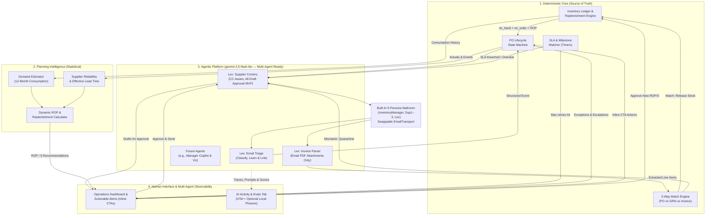
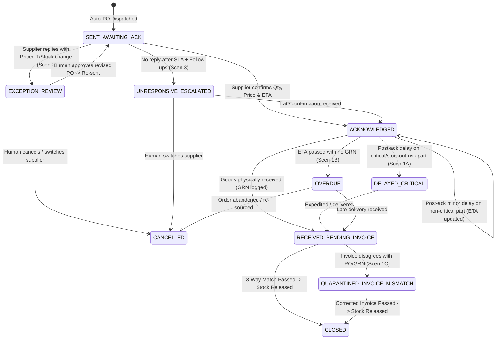

# Master PRD: Autonomous Demand-to-Delivery & Inventory Planning System

**Document Status:** Approved Baseline v1.0 (All Product Decisions Locked)  
**MVP Agent:** **Lex** (first agent on a multi-agent platform, powered by `gemini-3.5-flash-lite` via `$GEMINI_API_KEY`; future agents such as a Manager Query & Visualization Copilot will plug into the same backbone)  
**Target Users:** Inventory Management Team (`InventoryManager`), Procurement Team  
**Currency / Locale Context:** INR (₹), Industrial / Engineering Parts Inventory  

---

## 1. Executive Summary

### The Problem
The inventory team currently operates reactively across the **Demand → Purchase Order → Delivery → Invoice → Usable Stock** lifecycle. While triggering purchase orders is straightforward, everything *after* a PO is sent relies on manual email tracking and human memory. As email volume grows, critical supplier communications slip through the cracks—and the team only discovers a problem when an engineer walks to the shelf and hits a **stockout**.

Specifically, six operational failures hurt the business most today:

| # | Pain Point | What Happens Today | Business Impact |
|---|---|---|---|
| **1** | **Unacknowledged POs (Ghosting)** | Supplier never replies to a PO; nobody tracks or follows up. | Silent multi-week delays ending in surprise stockouts. |
| **2** | **Missed Supplier Exceptions** | Supplier emails back about price hikes, lead-time shifts, or unavailability; email gets buried in inbox. | PO sits unresolved for weeks until stockout forces emergency escalation. |
| **3** | **Unassessed Post-Ack Delays** | Supplier agrees to PO, later emails a delay; manual assessment of urgency is slow or missed. | Critical parts aren't expedited in time; non-critical delays create unnecessary noise. |
| **4** | **Silent Non-Deliveries** | Supplier acknowledges PO, misses delivery date without saying anything; nobody monitors overdue orders. | Discovered only after stock runs out. |
| **5** | **PO–Invoice Mismatches** | Shipment arrives, but invoice price or quantity disagrees with the PO; stock is frozen until corrected. | Usable stock sits quarantined while staff manually chase revised invoices. |
| **6** | **Static, Blind Planning** | No demand forecasting; quarterly supplier lead-time quotes are trusted despite chronic lateness. | Reorder points are either too low (stockouts) or inflated blindly (excess working capital). |

### The Solution
Build a **Demand-to-Delivery Control System** that combines a **deterministic operational backbone** (strict inventory rules, PO state tracking, SLA timers, and statistical planning math) with **targeted AI agents** (reading messy supplier emails, extracting invoice data, conducting routine supplier follow-ups, and framing decisions for humans).

The team shifts from **chasing every PO manually** to **managing by exception**—stepping in only when a decision genuinely requires human judgment (e.g., approving a price increase, authorizing an expedite, or switching suppliers).

---

## 2. Design Philosophy: Right Tool for Each Job

Not every problem should be solved with an LLM agent. Using agents for arithmetic or state tracking introduces hallucination risk where simple code is 100% reliable. Conversely, rigid scripts fail on messy human emails and varied supplier invoice formats.

### Deterministic Code vs. AI Agents

| System Capability | Approach | Why |
|---|---|---|
| **Reorder Triggering & Duplicate-PO Guard** | Deterministic Rules | Must be exact, instant, and auditable. |
| **PO State Machine & SLA Timers** | Deterministic Workflow | Time-based triggers (unacknowledged, overdue, hold duration) must never be forgotten or hallucinated. |
| **3-Way Match Math (PO vs. GRN vs. Invoice)** | Deterministic Arithmetic | Exact price/quantity verification belongs in code, never in an LLM. |
| **Demand Forecasting, Supplier Scoring & Dynamic ROP** | Statistical Formulas | Transparent, reproducible math the manager can inspect and trust. |
| **Inbound Supplier Email Triage** | **AI Agent (Lex)** | Supplier emails are unstructured, off-thread, ambiguous, and vary widely in phrasing. |
| **Invoice Document Parsing (Email PDFs)** | **AI Extraction (Lex) + Schema Validation** | Every supplier uses a different PDF invoice layout. *(MVP scope: PDF attachments via email only.)* |
| **Supplier Outreach & Follow-ups** | **AI Agent (Lex — Draft-First Guardrailed)** | Needs context from the specific PO/thread, proper CCs, polite tone, and ability to adapt to replies. |
| **Actionable Alerts for Humans** | **AI Synthesis (Lex) over Verified Data** | Turns raw numbers + email threads into a concise alert with suggested actions and inline 1-click CTAs. |

### Human-in-the-Loop (HITL) Trust Boundaries
To earn operational trust from day one, **Lex** operates in **Draft-First Supervised Mode** for outbound communications while running monitoring, reading, matching, and analytics autonomously:

- **Autonomous (No Waiting on Humans):**
  - Monitor inventory position and trigger replenishment PO records when `inventory_position < ROP`.
  - Read, classify, and link inbound supplier emails to the right PO and persona (`Sup1`, `Sup2`, `Sup3`), learning from supplier response patterns over time.
  - Extract structured line items from **PDF invoice attachments received via email**, run deterministic 3-way match, and auto-release clean shipments into usable stock.
  - Quarantine mismatched shipments immediately (`quarantined_stock`) so defective/unreconciled parts cannot be issued.
  - Surface concise **Actionable Alerts** to `InventoryManager` with embedded CTAs to execute table updates, notes, and decisions directly.
  - Draft context-aware outbound emails (including appropriate **CCs**, e.g., `InventoryManager` / Procurement) for POs, follow-ups, delay responses, and invoice correction requests.
  - Recalculate supplier reliability scores, effective lead times, and dynamic ROP / Replenishment Point recommendations.

- **Human Approval Required (`InventoryManager`) — MVP Hard Rule:**
  - **All outbound emails drafted by Lex** (including auto-generated PO emails, follow-ups, delay replies, and invoice discrepancy notices) require `InventoryManager` approval before dispatch in the MVP.
  - **Autonomy Progression Module (Post-MVP / Built-In Readiness):** Every approval/edit/rejection of Lex's drafts is tracked per action category (e.g., *Standard PO Send*, *Ack Reminder*, *Invoice Discrepancy Notice*). Based on Lex's observed track record (approval rate without edits), a dedicated **Autonomy Control** module will allow the manager to progressively graduate specific email categories from *Approval Required* to *Auto-Send*.
  - Approving supplier price changes, quantity changes, or material lead-time revisions (updating PO table entries via alert CTAs).
  - Authorizing expedite actions for critical delayed parts.
  - Switching a PO to a **backup supplier** or cancelling an active PO.
  - Overriding a quarantined shipment or approving dynamic ROP / Replenishment Point updates.

---

## 3. High-Level Architecture

---

## 4. Functional Requirements

### Module 1: Inventory Monitoring & Auto-PO Triggering

#### Mechanics
Each part maintains:
- `on_hand_stock`: Physically available, *usable* stock (excludes quarantined shipments).
- `quarantined_stock`: Physically delivered stock blocked due to invoice mismatch or inspection.
- `on_order_stock`: Units on open, active POs not yet received.
- `inventory_position`: **`on_hand_stock + on_order_stock`** (used for all replenishment trigger checks).
- `reorder_point (ROP / s)`: Threshold that triggers replenishment.
- `replenishment_point (S)`: Target order-up-to stock level.
- `criticality`: `CRITICAL` | `STANDARD` | `LOW` (drives safety stock, SLA urgency, and escalation paths).
- **Supplier Sourcing:** Each part has a **primary supplier** and one or more **backup suppliers** (ranked by priority and reliability score) so the team can fail over when the primary supplier ghosts, hikes prices, or runs out of stock.

#### Trigger Rule (Locked: Inventory Position Policy)
When stock is withdrawn (e.g., an engineer issues parts from inventory):
1. Decrement `on_hand_stock` and record an immutable transaction in the `InventoryLedger`.
2. Compute **`inventory_position = on_hand_stock + on_order_stock`**.
3. Check condition: **`inventory_position < reorder_point`**.
4. If true:
   - Calculate **`order_qty = replenishment_point - inventory_position`** (rounded up to supplier MOQ / pack size if configured).
   - Automatically generate a Purchase Order for the primary supplier at the agreed contract price and quoted lead time, incrementing `on_order_stock` by `order_qty`.
   - Lex prepares the PO email (with appropriate CCs) for `InventoryManager` approval/dispatch, transitioning the PO to `SENT_AWAITING_ACK` once sent.
5. If additional stock is consumed while a PO is already open (e.g., `on_hand` drops from 2 to 0 while 4 units are in transit):
   - `inventory_position = 0 + 4 = 4` (`>= ROP 3`) → **No duplicate PO is triggered.**
   - *Smart enhancement:* If `on_hand` hits a critical threshold or 0 while the open PO is still far from ETA, raise an **Accelerated Burn / Early Stockout Risk** alert so the team knows consumption spiked faster than expected.

> **Walkthrough Example:**  
> `ROP = 3`, `Replenishment Point = 6`, `on_hand = 4`, `on_order = 0` (`inventory_position = 4`).  
> - Engineer withdraws 2 units → `on_hand = 2`, `on_order = 0` → `inventory_position = 2` (`< 3`) → Auto-PO triggered for `6 - 2 = 4` units. Now `on_order = 4`, `inventory_position = 6`.  
> - While the 4 units are in transit, another 2 units are consumed → `on_hand = 0`, `on_order = 4` → `inventory_position = 4` (`>= 3`) → **No duplicate PO triggered.**  
> - When the 4 units arrive and invoice matches → `on_hand` becomes `4`, `on_order` becomes `0`, PO closes.  
> - *(Bonus benefit over a naive boolean lock: if only 2 of 4 arrive in a partial shipment and get consumed, `inventory_position` still tracks the remaining 2 `on_order` cleanly.)*

---

### Module 2: PO Lifecycle State Machine & Exception Handling

Every PO moves through an explicit, auditable state machine. Nothing disappears into an inbox.

#### Scenario-by-Scenario Behavior

##### Scenario 3: Supplier Does Not Respond (Ghosting)
- **Trigger:** PO remains in `SENT_AWAITING_ACK` past the acknowledgment SLA (default: 24h for `CRITICAL`, 48h for `STANDARD`/`LOW`).
- **Automated Action (Lex — Draft-First in MVP):**
  - **Follow-up #1 (T + SLA):** Lex drafts a polite reminder referencing PO#, part, qty, and requested delivery date (CC'ing `InventoryManager`) and surfaces it in an alert with a 1-click **Approve & Send** CTA.
  - **Follow-up #2 (T + 2×SLA):** Lex drafts a firmer follow-up flagging urgency for manager approval.
  - **Escalation (T + 3×SLA, or shorter for Critical):** State moves to `UNRESPONSIVE_ESCALATED`. High-priority alert created for `InventoryManager` with supplier contact phone number, reliability score, Supplier Memory notes, and 1-click **Switch to Backup Supplier** CTA.
- **Outcome:** Zero POs ever silently stall unacknowledged.

##### Scenario 2: Supplier Replies with Exceptions (Price, Lead Time, or Unavailability)
- **Trigger:** Inbound email arrives from supplier.
- **Agent Action (Lex Email Triage):**
  1. Matches email to the open PO (using PO#, thread ID, supplier persona/email, and part name/SKU).
  2. Classifies reply into structured intent:
     - `ACKNOWLEDGED` (matches PO terms)
     - `PRICE_CHANGE` (extracts proposed unit price & currency)
     - `LEAD_TIME_CHANGE` (extracts proposed ETA / lead time)
     - `PARTIAL_AVAILABILITY` (extracts available qty)
     - `OUT_OF_STOCK / UNAVAILABLE`
     - `AMBIGUOUS / NEEDS_CLARIFICATION` (low confidence → immediately flags human, never guesses)
  3. **Deterministic Impact Calculation:** System computes:
     - Price variance (₹ and %)
     - Projected stockout date based on `on_hand / avg_daily_demand` vs. proposed ETA
  4. **Routing:** Moves PO to `EXCEPTION_REVIEW`, updates Supplier Memory if a behavioral pattern is observed, and creates a concise **Alert** for `InventoryManager` with:
     - Summary + extracted structured diff (e.g., `Price: ₹100 → ₹125 (+25%)`, `ETA: Dec 5 → Dec 22`)
     - Stockout impact (e.g., *"Stockout projected Dec 14 — 8 days before proposed delivery"*)
     - Embedded inline CTAs: **Approve & Update PO Table + Draft Revised PO**, **Add Note**, **Switch to Backup Supplier**, **Cancel PO**.

##### Scenario 1A: Post-Acknowledgment Delay Notice
- **Trigger:** Supplier previously acknowledged the PO, then later emails stating they cannot meet the promised date.
- **Agent + Deterministic Triage (Lex):**
  1. Lex extracts the newly proposed delivery date and stated reason.
  2. System calculates **Stockout Risk**:
     - `projected_days_of_supply = on_hand_stock / avg_daily_demand`
     - `days_to_new_eta = new_eta - today`
     - Risk = `HIGH` if `part.criticality == CRITICAL` OR `days_to_new_eta >= (projected_days_of_supply - buffer_days)`.
  3. **Branching:**
     - **Critical / High Stockout Risk:** Moves PO to `DELAYED_CRITICAL`. Immediately alerts `InventoryManager` (+ Procurement CC) with an **Expedite Request** card showing stockout countdown, supplier history, a pre-drafted expedite email for approval, and backup supplier option.
     - **Non-Critical & Safe Buffer:** Updates `revised_eta` (while preserving the *original* `promised_eta` for supplier reliability scoring!), logs a low-priority informational notice, and optionally prepares a quiet acknowledgment draft without triggering alarm fatigue.

##### Scenario 1B: Silent Non-Delivery (No Shipment, No Communication)
- **Proactive Prevention (Pre-ETA Check-in):**
  - For `CRITICAL` parts or suppliers with Reliability Score `< 75`, at `ETA - 3 days`, Lex drafts a brief check-in email asking for dispatch confirmation / tracking details (queued for manager approval in MVP).
- **Overdue Detection:**
  - If `today > promised_eta + grace_period (e.g., 1 business day)` and no Goods Receipt (GRN) has been recorded:
    1. System automatically transitions PO to `OVERDUE`.
    2. Lex drafts an urgent shipment status email to the supplier (CC'ing `InventoryManager`) for 1-click approval.
    3. Escalation alert is raised immediately for `CRITICAL` parts (or after 48h without reply for `STANDARD` parts), displaying days until stockout and backup supplier option.
    4. Supplier's late delivery event is recorded toward their reliability score.

---

### Module 3: Delivery, Invoice Verification & Quarantine Release (Scenario 1C)

When a shipment physically arrives at the warehouse:
1. Warehouse / Inventory staff logs a **Goods Receipt (GRN)** against the PO: `received_qty`, `received_date`, and condition (`OK` / `DAMAGED`).
2. When the supplier sends the invoice as a **PDF attachment via email** *(MVP scope: email PDF attachments only)*:
   - **Invoice Parser (Lex / `gemini-3.5-flash-lite` multimodal)** extracts: `invoice_number`, `po_reference`, line items (`part_code/description`, `invoiced_qty`, `unit_price`, `tax`, `total_amount`).
   - **3-Way Match Engine (Deterministic Code)** compares:
     - `invoiced_qty` vs. `po_qty` vs. `grn_received_qty`
     - `invoiced_unit_price` vs. `po_unit_price` (within configurable rounding tolerance, e.g., ±₹0.50)
     - Line totals and grand total arithmetic.

#### Match Outcomes
- **Exact Match:**
  - Invoice marked `APPROVED`.
  - `received_qty` moves immediately into usable `on_hand_stock`.
  - PO transitions to `CLOSED`.
  - Actual delivery date and clean-invoice flag feed into Supplier Reliability Score.
- **Mismatch Detected** (e.g., PO = 100 units @ ₹100; Invoice = 100 units @ ₹150, OR 90 units @ ₹100):
  - Received goods are placed in **`quarantined_stock`** (strictly unavailable for engineering withdrawal) and PO transitions to `QUARANTINED_INVOICE_MISMATCH`.
  - System generates an exact discrepancy record (e.g., *"Unit price ₹150 vs. agreed PO price ₹100 — excess ₹5,000"* or *"Invoiced qty 90 vs. PO/GRN qty 100 — short by 10 units"*).
  - **Resolution Loop (Lex + Manager Approval):**
    1. Lex creates an Alert for `InventoryManager` detailing the exact mismatch alongside a pre-drafted discrepancy email to the supplier (CC'ing `InventoryManager`) requesting a corrected PDF invoice (or credit note) — ready for 1-click **Approve & Send**.
    2. SLA timer monitors the correction request (drafts follow-up after 48h, escalates if unresolved after 4 days or if stockout risk climbs).
    3. When the revised PDF invoice arrives via email, Lex parses it and the 3-way match runs automatically again.
    4. Once matched, the system logs the resolution, **releases `quarantined_stock` → `on_hand_stock`**, closes the PO, and notifies `InventoryManager` that the parts are now ready for use.

---

### Module 4: Planning Intelligence Engine

This module runs on a scheduled cadence (e.g., weekly, plus on-demand after major supplier events) using pure, inspectable statistical models.

#### 1. Demand Forecasting (Replacing Manual 12-Month Eyeballing)
- Uses the trailing 12 months of `InventoryLedger` consumption data.
- Computes:
  - **Average Daily Demand ($\bar{D}$):** Exponentially Weighted Moving Average (EWMA) across monthly consumption buckets, so recent demand shifts carry slightly more weight than 11-month-old data while still smoothing noise.
  - **Demand Variability ($\sigma_D$):** Standard deviation of daily/monthly consumption.
  - **Intermittent Demand Flag:** For slow-moving spare parts (where many months have zero consumption), flags the part as *lumpy/intermittent* and uses rolling peak/buffer logic rather than naive averages that under-stock.
- Supports **Human Event Overrides** (e.g., *"Planned plant maintenance in January: expect +10 units"*).

#### 2. Supplier Reliability Score & Effective Lead Time
Instead of blindly trusting a supplier's quarterly quote (e.g., "15 days"), the system tracks what the supplier *actually does*:

- **Four Core Supplier Metrics (rolling 12-month window):**
  1. **On-Time Delivery (OTD) Rate (40% weight):** % of POs delivered on or before the originally promised date, penalized further by average days late.
  2. **Lead Time Consistency (25% weight):** Spread ($\sigma_L$) between quoted and actual lead times.
  3. **Invoice Accuracy Rate (20% weight):** % of shipments passing 3-way match on the first invoice without quarantine.
  4. **Communication Responsiveness (15% weight):** % of POs acknowledged within SLA without needing follow-up nudges.
- Outputs a clear **Supplier Reliability Score (0–100)** with color tiers (`≥85 Reliable`, `65–84 Watch`, `<65 Unreliable`).
- **Effective Lead Time ($\bar{L}_{\text{eff}}$):**
  - If a supplier has `< 3` historical deliveries for a part: use the supplier's quarterly **Quoted Lead Time** (cold-start fallback).
  - If `≥ 3` deliveries exist: blend quoted and historical actual lead times, heavily weighting actual performance (e.g., `0.25 × Quoted + 0.75 × Actual_Mean`, floored at `Actual_Mean` when the supplier is chronically late) and compute actual lead-time standard deviation ($\sigma_L$).
  - *Example:* Supplier quotes **15 days** every quarter, but their last 5 deliveries took **22, 25, 19, 28, 24 days** (mean 23.6d). The planning engine uses **~24 days** (plus variance) instead of 15 days, and flags the supplier as **Unreliable**.
- **Supplier Memory (Qualitative Learning — Visible & Editable):**
  - Alongside quantitative metrics, Lex maintains concise, human-readable behavioral memory notes per supplier (e.g., *"Sup3 frequently revises prices post-PO; verify stock availability before confirming timelines"*, *"Sup2 invoices often carry stale pricing; verify unit price carefully"*).
  - Lex reads these notes before drafting emails and alerts, and `InventoryManager` can view, edit, add, or delete any memory note directly in the Supplier Scorecard view.

#### 3. Dynamic Reorder Point (ROP) & Replenishment Point ($S$)
Computed transparently using standard inventory control formulas:

$$\text{Safety Stock (SS)} = Z_{\text{criticality}} \times \sqrt{\left(\bar{L}_{\text{eff}} \times \sigma_D^2\right) + \left(\bar{D}^2 \times \sigma_L^2\right)}$$

$$\text{Dynamic ROP } (s) = \left\lceil \bar{D} \times \bar{L}_{\text{eff}} + \text{SS} \right\rceil$$

$$\text{Dynamic Replenishment Point } (S) = \text{ROP} + \left\lceil \bar{D} \times \text{Target\_Coverage\_Days} \right\rceil$$

Where $Z_{\text{criticality}}$ reflects the business tolerance for stockouts:
- `CRITICAL` parts: 98% service level ($Z = 2.05$)
- `STANDARD` parts: 95% service level ($Z = 1.65$)
- `LOW` parts: 90% service level ($Z = 1.28$)

**Explainability & Control:**  
Every recommended change to ROP or $S$ is presented as a plain-English card rather than a black-box number:  
> *"Part #BRG-402 (Bearing): Recommend raising ROP from **3 → 5** and Replenishment Point from **6 → 9**. Reason: Supplier Apex Tools quoted 15d lead time, but averaged 24d over the last 5 orders (+9d effective lead time)."*  
The manager can **Approve**, **Edit**, or **Dismiss** with one click.

---

### Module 5: Operations Dashboard & Actionable Alerts

To eliminate inbox chaos, the UI is designed around **simple, actionable alerts**, not tables of healthy orders:

1. **Actionable Alerts Queue (Home Screen for `InventoryManager`):**
   - Sorted by **Urgency Score** (Criticality × Days-to-Stockout × Escalation Severity).
   - Displays only items requiring human attention:
     - **Lex Outbound Email Drafts** awaiting manager approval (showing `To`, `CC`, subject, editable body, and 1-click **Approve & Send**)
     - **Supplier Exception Replies** (Scenario 2: price, lead-time, or availability changes)
     - **Unresponsive Suppliers** past follow-up threshold (Scenario 3)
     - **Critical Delayed / Overdue Shipments** needing expedite (Scenarios 1A & 1B)
     - **Invoice Mismatches / Quarantine Holds** (Scenario 1C)
     - **Dynamic ROP / Replenishment Recommendations**
   - **Anatomy of Every Alert (Simple & Self-Contained):**
     - **Concise Summary:** 2–3 plain sentences explaining what happened and the stockout/cost impact.
     - **Suggested Actions:** What Lex recommends and why (e.g., showing backup supplier option with higher reliability score).
     - **Embedded Inline CTAs:** Direct buttons inside the alert card that immediately execute the change without navigating away—such as **Update PO Entry** (price/qty/ETA), **Add Note to PO/Supplier**, **Approve & Send Draft Email**, **Switch to Backup Supplier**, or **Approve New ROP/S**.
2. **Inventory & Part Health View:**
   - Live `on_hand`, `quarantined`, `on_order`, `inventory_position`, primary + backup supplier, current vs. recommended ROP/$S$, days of supply, and quick "Issue / Consume Stock" action.
3. **PO Tracker & Timeline View:**
   - Visual status of all active POs with full audit log: every email sent/received/drafted, Lex's classification & reasoning, SLA countdowns, GRN, notes, and invoice match breakdown.
4. **Supplier Scorecard View:**
   - Side-by-side comparison of `Sup1`, `Sup2`, and `Sup3`: Reliability score (0–100), Quoted vs. Actual Lead Time trend, OTD %, Invoice Accuracy %, Responsiveness %, and the editable **Supplier Memory** notes Lex has learned.

---

### Module 6: Multi-Agent Evals, Observability & Autonomy Progression (Lightweight Hybrid)

**Lex is Agent #1**, not the only agent. The platform is designed to host additional specialized agents over time (e.g., a **Manager Copilot** for natural-language queries and data visualization with specialized tools, plus future procurement/forecasting agents). To stay **agent-agnostic** while remaining dead simple for a non-technical user, we use a **Lightweight Hybrid** architecture:

1. **Shared Agent-Agnostic Instrumentation (`AgentTracer`):**
   - Every agent (`lex`, future `copilot`, etc.) runs through one shared wrapper that writes **plain-English summary records to SQLite** AND emits **standard OpenTelemetry (OTel) spans**.
   - Captures: `agent_name`, trigger, tool calls / inputs, decision & confidence score, output summary, latency, token usage, cost (₹), and human feedback (`approved` / `edited` / `rejected`).
2. **In-App "AI Activity & Health" Tab (Day-to-Day Non-Technical View):**
   - **Activity Feed:** Filterable by agent (`All | Lex | Future Agents`), showing plain-English summaries of every action, confidence score, cost in ₹, and an optional expandable view for exact prompts/outputs.
   - **Pluggable Evals Scorecard:** Each agent registers a simple declarative YAML/JSON golden test file (`evals/lex.yaml`, later `evals/copilot.yaml`, etc.). Clicking **"Run Evals"** outputs a clear green/red scorecard (e.g., *19/20 Passed — 95%*) with plain-English explanations of any failed case.
   - *Lex's initial Golden Test Suite covers:* messy price-hike email, ambiguous email, partial stock reply, critical vs. non-critical delay, PDF invoice price mismatch, PDF invoice qty mismatch, clean PDF invoice, and CC correctness.
3. **Optional Local Arize Phoenix (`phoenix serve`) for Deep Multi-Step Debugging:**
   - Because `AgentTracer` emits standard OpenTelemetry, launching **Arize Phoenix** locally (`phoenix serve` — no Docker, no cloud account) automatically visualizes nested multi-step tool calls for complex future agents like the Manager Copilot with zero re-instrumentation.
4. **Autonomy Progression Tracking (Post-MVP Graduation Module):**
   - Because **all Lex outbound emails require `InventoryManager` approval in MVP**, the system records every draft's outcome (`Approved as-is`, `Approved with edits`, `Rejected`) by email category (`PO_DISPATCH`, `ACK_REMINDER`, `OVERDUE_CHASE`, `INVOICE_DISCREPANCY`).
   - A dedicated **Autonomy Control** module will use this observed track record to let the manager selectively unlock higher autonomy per category.

---

## 5. Core Data Model (Conceptual)

Keep the data model simple and relational (SQLite/PostgreSQL):

- **`Part`**: `id`, `sku`, `name`, `criticality`, `on_hand_stock`, `quarantined_stock`, `rop`, `replenishment_point`, `target_coverage_days`
- **`Supplier`**: `id`, `persona_key` (`sup1` | `sup2` | `sup3`), `name`, `email`, `phone`, `reliability_score`, `otd_rate`, `invoice_accuracy_rate`, `response_rate`
- **`SupplierMemoryNote`**: `id`, `supplier_id`, `note`, `source` (`LEX_LEARNED` | `MANAGER_ADDED`), `created_at`, `updated_at`
- **`PartSupplierTerm`**: `part_id`, `supplier_id`, `supplier_rank` (`1` = Primary, `2+` = Backup), `agreed_unit_price`, `currency`, `quoted_lead_time_days`, `effective_lead_time_days`, `lead_time_std_dev`, `moq`, `last_validated_at`
- **`InventoryTransaction`**: `id`, `part_id`, `type` (`CONSUMPTION` | `RECEIPT_RELEASED` | `ADJUSTMENT`), `qty_delta`, `timestamp`, `note`
- **`PurchaseOrder`**: `id`, `po_number`, `part_id`, `supplier_id`, `qty`, `unit_price`, `status`, `notes`, `created_at`, `sent_at`, `promised_eta`, `revised_eta`, `follow_up_count`, `next_sla_check_at`
- **`POCommunication`**: `id`, `po_id`, `thread_id`, `direction` (`OUTBOUND` | `INBOUND`), `status` (`DRAFT_PENDING_APPROVAL` | `SENT` | `RECEIVED`), `from_persona`, `to_personas`, `cc_personas`, `subject`, `body`, `attachment_path`, `ai_classification`, `ai_extracted_json`, `ai_confidence`, `approval_outcome` (`APPROVED_AS_IS` | `APPROVED_EDITED` | `REJECTED`), `timestamp`
- **`GoodsReceipt (GRN)`**: `id`, `po_id`, `received_qty`, `received_at`, `status` (`HELD_QUARANTINE` | `RELEASED`)
- **`Invoice`**: `id`, `po_id`, `invoice_number`, `pdf_path`, `extracted_qty`, `extracted_unit_price`, `extracted_total`, `match_status` (`MATCHED` | `MISMATCH_PRICE` | `MISMATCH_QTY` | `MISMATCH_BOTH`), `discrepancy_summary`, `version`, `received_at`
- **`ActionItem` (Alert)**: `id`, `type`, `severity`, `po_id`, `part_id`, `draft_comm_id`, `title`, `summary`, `suggested_actions_json`, `cta_payload_json`, `status` (`OPEN` | `RESOLVED` | `DISMISSED`), `assigned_team` (`INVENTORY` | `PROCUREMENT`)
- **`AgentTrace` & `EvalRun`**: Agent-agnostic records capturing every LLM/tool invocation across all agents (`agent_name`, inputs, tool calls, output, confidence, tokens, cost, latency, linked entity) and per-agent golden-dataset eval runs.
- **`AutonomyPolicy`**: Per-agent, per-action-category trust config (`APPROVAL_REQUIRED` vs. future `AUTO_SEND`) paired with observed edit-free approval metrics.

---

## 6. Prototype Strategy & Demo Design

Since this is a **prototype** designed to validate the solution with the Inventory Manager before full ERP integration, we optimize for **clarity, realism, and live demonstrability**.

### The 5 Demo Personas & Built-In Mailroom

The prototype includes a **Built-In Multi-Persona Mailroom** (Gmail-style in-app webmail backed by a swappable `EmailTransport` interface, so real IMAP/Gmail/Outlook can be plugged in for Phase 2 without changing Lex or the PO workflow). No external email accounts are required, and email timestamps stay synchronized with the Simulated Clock.

The operator can switch into any human/supplier inbox and manually compose or reply (with CC and PDF attachments) to any other inbox—except **Lex**, who acts autonomously, recognizes who each persona is, CCs relevant stakeholders, drafts all outbound emails for `InventoryManager` approval (in MVP), and learns from supplier response history (both quantitative metrics and editable Supplier Memory notes).

*(Demo Scenario Workflow: We will build the real working system first without hardcoded canned demos. Once the system is running end-to-end, we will design and test realistic scenarios together and save the ones we like best as reusable **Quick-Fill Demo Presets**.)*

| Persona / Inbox | Role | Behavioral Profile (Purpose in Demo) |
|---|---|---|
| **`InventoryManager`** | Human Decision-Maker | Receives Lex's alerts and outbound email drafts for approval; can also email suppliers directly or execute inline alert CTAs. |
| **`Lex`** | Autonomous AI Agent (Read-Only Inbox View) | Reads all inbound supplier emails & PDF invoices, creates alerts with inline CTAs, drafts all outbound emails (CC-aware) for manager approval, and updates supplier learnings & memory. *(No manual "Send As Lex" button.)* |
| **`Sup1`** | Reliable Benchmark Supplier | Fast acknowledgments, accurate invoices, delivers on time (~12–15d). Serves as the **reliable primary or backup supplier** to demonstrate failover and clean Scenario 1 flows. |
| **`Sup2`** | Chronically Late & Invoice-Prone Supplier | Quotes 15d lead time every quarter, but historically delivers in 22–28d and occasionally sends mismatched PDF invoices. Showcases **Dynamic Effective Lead Time, Reliability Score drop, Silent Non-Delivery (1B), and Invoice Quarantine (1C)**. |
| **`Sup3`** | Unresponsive / Volatile Supplier | Frequently ghosts POs (no reply) or replies late with sudden price hikes / stock unavailability. Showcases **Ghosting Escalations (Scenario 3), Exception Triage (Scenario 2), and Switching to Backup Supplier (`Sup1`)**. |

### Prototype Scope vs. Phase 2 (Production)

| Area | Prototype (v1) | Production (Phase 2) |
|---|---|---|
| **Inventory & ERP Data** | Seeded realistic dataset (15–20 parts with primary + backup suppliers among `Sup1–Sup3`, 12 months consumption & PO history) + CSV import. | Bi-directional integration with company ERP (SAP / Tally / Oracle / NetSuite). |
| **Email Channel** | **Built-in 5-Persona Mailroom** (`InventoryManager`, `Sup1–3`, read-only `Lex`) with full manual compose/reply & PDF attachments, behind a swappable `EmailTransport` interface synced with the Simulated Clock. *(Quick-fill demo presets saved post-build after live testing.)* | Live dedicated procurement inbox (IMAP / Microsoft Graph / Gmail API) via the same `EmailTransport` interface. |
| **Outbound Approval Mode** | **All Lex outbound emails require `InventoryManager` approval** (tracking edit-free approval rate per category). | Graduated autonomy via the **Autonomy Control** module based on Lex's observed performance. |
| **LLM Provider** | Google Gemini API via `$GEMINI_API_KEY` using **`gemini-3.5-flash-lite`** (multimodal text + PDF). | Same (with pluggable provider interface + optional local fallback). |
| **Time & SLA Triggers** | **Simulated Clock ("Advance +1 Day / +7 Days / Jump to ETA")** so multi-week scenarios run live in seconds. | Real-time cron/event scheduler. |
| **Invoice Processing** | **PDF attachments via email only (MVP).** | Email PDFs + optional gate-scan OCR + ERP finance posting. |
| **Evals & Observability** | **Lightweight Hybrid:** Agent-agnostic in-app **AI Activity & Health** tab (plain-English feed + declarative YAML eval scorecards) emitting OpenTelemetry spans for optional local **Arize Phoenix** (`phoenix serve`). | Continuous multi-agent monitoring, drift alerts & regression gates. |

### End-to-End Prototype Acceptance Scenarios
The prototype is "done" when a live demo cleanly executes all seven scenarios end-to-end:

1. **Auto-PO & Inventory Position Guard:** Withdraw 2 units (`on_hand` 4 → 2, `inventory_position` 2 < ROP 3) → Auto-PO created for 4 units (`on_order = 4`, `inventory_position = 6`); Lex drafts PO email to `Sup1` for `InventoryManager` approval. Withdraw remaining 2 units (`on_hand` 2 → 0, `inventory_position` = 4 ≥ 3) → Verify **no second PO** is created.
2. **Scenario 3 (Supplier Ghosting — `Sup3`):** Send PO to `Sup3`, leave unacknowledged → Advance clock past SLA → Lex drafts follow-up #1 & #2 for approval → Advance again → Escalates to Actionable Alert with 1-click **Switch to Backup Supplier (`Sup1`)** CTA.
3. **Scenario 2 (Supplier Exception Reply — `Sup3`):** Send messy email from `Sup3` (*"Hi, raw material costs went up, price is now ₹135/unit and delivery will take 35 days"*) → Lex extracts price & lead-time diff, calculates stockout impact, creates simple Alert with inline CTAs → `InventoryManager` clicks **Revise PO Table & Send Revised PO** (or **Switch to Backup `Sup1`**).
4. **Scenario 1A (Post-Ack Delay — Critical vs. Non-Critical):** Supplier acks two POs (one `CRITICAL`, one `LOW`), then emails a 10-day delay on both → Critical part triggers high-priority Expedite Alert (with Procurement CC & backup supplier option); Low-criticality part with buffer updates ETA quietly without alarm fatigue.
5. **Scenario 1B (Silent Non-Delivery — `Sup2`):** `Sup2` acks PO, never delivers → Advance clock past promised ETA → System detects overdue PO with no GRN, Lex drafts urgent status-check email, creates overdue alert, and updates `Sup2`'s reliability score.
6. **Scenario 1C (Invoice Mismatch & Quarantine Release — `Sup2`):** Log GRN for 100 units (PO @ ₹100) → `Sup2` emails a **PDF invoice** for ₹150/unit → Lex parses PDF, 3-way match catches ₹5,000 mismatch, quarantines stock (`on_hand` unchanged), drafts discrepancy email for approval → `Sup2` emails corrected ₹100/unit PDF invoice → Lex re-verifies match and releases 100 units into usable `on_hand_stock`.
7. **Dynamic Planning & Supplier Scoring:** Show `Sup2` (quotes 15d, actually delivers ~24d) vs. `Sup1` (reliable ~13d) → Dashboard shows `Sup2`'s lowered Reliability Score, Effective Lead Time ~24d, and a transparent recommendation to raise ROP & Replenishment Point with inline **Approve New ROP/S** CTA.

---

## 7. Guardrails & Key Risks

| Risk | Why It Matters | Mitigation |
|---|---|---|
| **LLM Misreads a Supplier Email** | Treating a price hike as an "acknowledgment" would silently accept wrong terms. | Strict JSON schema output + confidence score; anything `< 0.85` confidence or ambiguous defaults to `NEEDS_HUMAN_REVIEW`. Never auto-approve commercial term changes. |
| **Agent Makes Unauthorized Commitments** | Agent might accidentally promise payment or agree to a delay/price in an email reply. | Lex operates in **Draft-First approval mode** for all outbound emails in MVP (and tightly scoped intents with explicit policy rules forbidding unauthorized commercial commitments). |
| **LLM Arithmetic Errors on Invoices** | LLMs can miscalculate line totals or unit price differences. | LLM only *extracts* raw fields from the invoice; deterministic code performs all multiplication, sum checks, and PO/GRN comparisons. |
| **Email Threading Chaos** | Suppliers reply with changed subjects, new threads, or omit PO numbers. | Multi-signal matching (Message-ID/In-Reply-To → PO# regex → supplier email + open POs for mentioned part); if ambiguous across multiple open POs, route to human rather than guessing. |
| **Alert Fatigue** | Alerting humans on every routine event reproduces inbox overload. | Silence on healthy flows; non-critical safe delays stay informational; Action Queue strictly ranks by stockout risk and criticality. |

---

## 8. Success Metrics (For Pilot & Production)

- **Zero Missed Supplier Exceptions:** 100% of supplier price/lead-time/unavailability emails surfaced to the Action Queue within minutes of arrival (vs. missed for weeks).
- **Acknowledgment Tracking:** 100% of unacknowledged POs followed up automatically within SLA.
- **Overdue Detection Lead Time:** Silent non-deliveries flagged within 24 hours of missed ETA (instead of discovered at stockout).
- **Invoice Quarantine Turnaround:** Measurable reduction in average days stock sits blocked waiting for corrected invoices.
- **Stockout Reduction:** Fewer emergency escalations and stockouts on critical/frequently consumed parts through dynamic ROP + effective lead time adjustments.

---

## 9. Decisions Log (All Product Decisions Locked)

- **Replenishment Trigger:** **Inventory Position** (`on_hand_stock + on_order_stock < ROP`, ordering `S - inventory_position`).
- **5 Personas & Email Layer:** Built-In 5-Persona Mailroom (`InventoryManager`, `Sup1`, `Sup2`, `Sup3`, and read-only autonomous agent **Lex**) behind a swappable `EmailTransport` interface (zero external email accounts; timestamps synced with Simulated Clock; full manual compose/reply + PDF attachments).
- **Lex Outbound Approval & Autonomy Progression:** **All Lex outbound emails require `InventoryManager` approval in MVP**; edit-free approval metrics per category are recorded to power a post-MVP **Autonomy Control** module.
- **Actionable Alerts:** Concise summary + suggested actions + inline CTAs right inside each alert card (updating PO table entries, adding notes, approving/sending drafts, switching suppliers).
- **Supplier Learning:** Both quantitative metrics (Reliability Score, OTD %, Effective Lead Time, Invoice Accuracy) and visible, editable **Supplier Memory** behavioral notes per supplier.
- **Invoice Input Format (MVP):** **PDF attachments via email only**.
- **LLM & Multi-Agent Readiness:** Google Gemini API (`$GEMINI_API_KEY`) using **`gemini-3.5-flash-lite`** *(verified active model ID)* on a multi-agent platform (Lex first; future agents such as a Manager Query & Visualization Copilot next).
- **Backup Suppliers:** Supported per part (`PartSupplierTerm.supplier_rank`) to demonstrate reliability and failover.
- **Evals & Observability:** **Lightweight Hybrid** — shared agent-agnostic `AgentTracer` writing SQLite summary rows + emitting OpenTelemetry spans; plain-English in-app **AI Activity & Health** tab (agent filter + declarative per-agent YAML eval scorecards) + optional local **Arize Phoenix** (`phoenix serve`) for deep multi-step tool-call traces.
- **Demo Presets Strategy:** Deferred until the working system is live — we will test and craft realistic scenarios together first, then save the best ones as reusable Quick-Fill Demo Presets.
