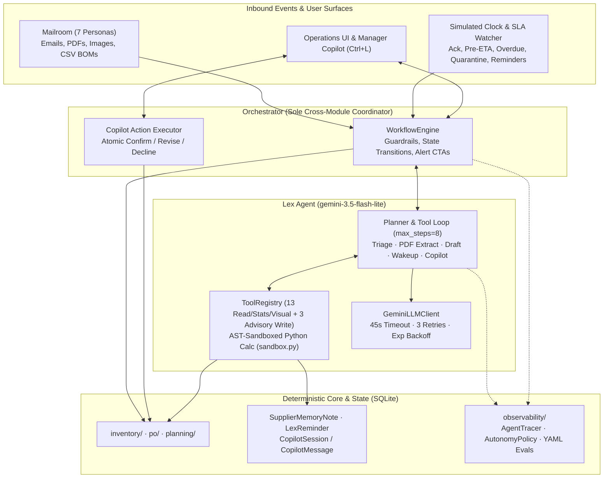

# InvPlan — Demand-to-Delivery Control Plane & Guardrailed Agentic Operations

> **Portfolio Prototype:** An end-to-end inventory planning and procurement operations system pairing a deterministic supply-chain core with a tool-using multimodal AI agent (**Lex**) and an interactive **Manager Copilot**.  
> **Stack:** Python 3.12 · FastAPI · SQLAlchemy 2.0 · SQLite · `google-genai` (`gemini-3.5-flash-lite`) · React 19 · TypeScript · Tailwind CSS · OpenTelemetry / Arize Phoenix

---

## 1. Problem Framing

Triggering a purchase order when stock runs low is the easy part of inventory management. Everything *after* the PO is sent—chasing unacknowledged orders, parsing unstructured supplier delays and price hikes, reconciling mismatched PDF invoices, and adjusting reorder points when demand shifts—collapses into manual email tracking and reactive firefighting. Teams usually discover a missed reply only when a technician walks to the shelf and hits a stockout.

InvPlan shifts procurement from **chasing every PO manually** to **managing by exception**.

### Users & Personas
The workspace models a 7-persona operational loop behind an abstract `EmailTransport` (`backend/mailroom/transport.py`):
- **`inventory_manager`**: Approves/edits PO dispatches and Lex email drafts, resolves supplier exceptions, releases quarantined goods, and queries the Manager Copilot.
- **`making`**: Shop-floor production team requesting parts via email (including `.csv` BOM attachments).
- **`procurement`**: Receives commercial/overdue escalations and expedite CCs.
- **`sup1` / `sup2` / `sup3`**: Three distinct supplier profiles (fast/accurate, chronically late with v1 billing errors, and slow-acknowledging with price volatility).
- **`lex`** *(read-only inbox)*: AI operations agent that triages inbound mail, extracts documents, drafts outbound replies, and answers manager queries—never allowed to send email directly (`403 Forbidden` on manual send).

### Core Workflow, Inputs & Outputs
- **Inputs:** Stock withdrawals (`Withdraw` or Making-team email requests), simulated clock advances (anchored at **Oct 1, 2026 1:00 PM IST** across 15 SKUs with 90 days of causal Jul–Sep history), supplier emails, multimodal attachments (`.pdf` invoices, credit notes, packing lists, dispatch advices; `.jpg`/`.png` dock damage photos & dispatch slips; `.csv` BOMs), Goods Receipt Notes (GRNs), and natural-language Copilot questions (`Ctrl+L`).
- **Outputs:** Audited PO state transitions, `DRAFT_PENDING_APPROVAL` outbound emails, prioritized `ActionItem` alerts with 1-click CTAs (*Approve & Send PO*, *Edit PO*, *Switch to Backup Supplier*, *Approve Net Settlement*, *Release Usable Qty*), quarantine holds, statistical analyses, and interactive SVG charts/diagrams.

### Hard Constraints
1. **Never use an LLM for arithmetic or state transitions.** Inventory position, 3-way invoice matching (`invoice_qty == grn_received_qty`, `±₹0.50` unit price tolerance), EWMA demand forecasting (`α = 0.30`), supplier reliability scoring (`40/25/20/15`), dynamic `ROP/T` (`Z`-factors `2.05`/`1.65`/`1.28`), and the PO state machine are 100% deterministic Python.
2. **Draft-First Outbound Rule:** Every email drafted by Lex enters `DRAFT_PENDING_APPROVAL` and requires `InventoryManager` approval before dispatch.
3. **Zero Silent Mutations:** Low confidence (`< 0.85`), foreign-currency quotes (`USD` vs `INR`), encrypted/consolidated PDFs, and policy-violating Copilot requests escalate without mutating POs or stock.
4. **Simulated Time:** Domain logic never calls `datetime.now()` or `datetime.utcnow()`; all timestamps and SLA timers run off a persisted `SimulatedClock` (`core.clock.now()`).

---

## 2. Agent Design

InvPlan separates **deterministic state & math** (`inventory/`, `po/`, `planning/`, `mailroom/`), **stateless/structured LLM reasoning** (`agents/lex/`), and **cross-domain orchestration** (`orchestrator/`).



### Key Architectural Choices
- **Planner (`LexAgent`):** Runs structured single-shot extraction (`temperature=0.0` for PDFs/drafts) or multi-turn tool-calling loops (`generate_with_tools`, `max_steps=8`, `AutomaticFunctionCallingConfig(disable=True)`) returning strict Pydantic schemas (`EmailTriageResult`, `InvoiceExtractionResult`, `EmailDraftResult`, `ReminderWakeupResult`, `CopilotQueryResult`).
- **Memory & State:**
  - *Long-term operational memory:* `SupplierMemoryNote` rows (deduplicated via Jaccard/substring checks) capture qualitative supplier patterns (e.g., chronic billing surcharges) and are injected into triage, drafting, and pre-delivery checks.
  - *Temporal state:* `LexReminder` persists variable N-day deferrals (e.g., supplier promises tracking in 4 days → Lex checks runway via `run_sandbox_calc` and schedules a wakeup without nagging early).
  - *Conversational state:* `CopilotSession` and `CopilotMessage` persist multi-turn Copilot context, visual specs, and action-proposal statuses (`PENDING_CONFIRMATION`, `EXECUTED`, `REVISED`, `DECLINED`).
- **Guardrails:**
  - Agents cannot import `inventory/`, `po/`, `planning/`, or `mailroom/` and never write to business tables directly.
  - `EmailTriageResult` with `confidence < 0.85` or unresolved POs forces `AMBIGUOUS` escalation; `CURRENCY_MISMATCH` blocks blind PO price updates; `INVOICE_EXTRACTION_REVIEW` catches encrypted, blurry, empty, or multi-PO PDFs.
  - `EmailDraftResult` forbids unauthorized commercial commitments (accepting price hikes, waiving penalties) and enforces `₹`/`INR` grounding plus mandatory `inventory_manager` / `procurement` CCs on escalations.
- **Retries & Resilience:** `GeminiLLMClient` enforces a `45.0s` HTTP timeout and retries transient errors (`408`, `429`, `500`, `502`, `503`, `504`, timeouts, connection errors) up to `3` times with `0.5s` exponential backoff. Unrecoverable failures degrade gracefully to `AMBIGUOUS_EMAIL` alerts or HTTP `200` (`degraded: true`) Copilot notices—never `500` crashes.

---

## 3. Tool Use

Tools are defined domain-agnostically in `backend/agents/tools.py` (`ToolSpec`, `ToolResult`, `ToolRegistry`) and bound to SQLAlchemy sessions in `backend/orchestrator/lex_tools.py`.

### Permissions & Tool Inventory (16 Tools)
- **Read-Only Query, Analytics & Visual Tools (`read_only=True`, 13 tools):**
  - *State inspection:* `list_parts_summary`, `list_alerts`, `get_planning_overview`, `get_part_snapshot`, `get_consumption_history`, `get_po_details`, `list_open_pos`, `get_supplier_profile`, `get_mailroom_thread`.
  - *Sandboxed compute:* `run_sandbox_calc` executes Lex-written Python inside an AST-validated, `sys.settrace` step- and wall-clock-bounded sandbox (`backend/agents/sandbox.py`) permitting only `math`, `statistics`, `datetime`/`timedelta`, `decimal`, and `json` while blocking unsafe imports, I/O, `eval`/`exec`, dunder escapes, and wall-clock `.now()`/`.today()`.
  - *Deterministic stats & visuals:* `run_statistical_analysis` (`part_demand_stats`, `inventory_abc_pareto`, `supplier_benchmark`, `series_stats`), `render_chart` (`bar`, `grouped_bar`, `line`, `area`, `donut`, `scatter`), and `render_diagram` (`flow`, `decision`, `timeline`).
- **Bounded Advisory Write Tools (`read_only=False`, 3 tools):**
  - `schedule_lex_reminder`, `propose_memory_note`, and `create_advisory_alert`.
  - In **Manager Copilot** mode, `ToolRegistry.read_only_view()` (`read_only_only=True`) strips all 3 write tools so Copilot reasoning is strictly read-only.
- **In-Chat Action Execution (`copilot_actions.py`):** When the manager asks Copilot to act (across 15 `CopilotActionType` operations such as `CREATE_MANUAL_PO`, `SWITCH_BACKUP_SUPPLIER`, `APPLY_ROP_RECOMMENDATION`, or `RECORD_GRN`), Lex returns structured `CopilotProposedAction` cards. Nothing runs until the user clicks **[Confirm & Execute]** (atomic DB transaction; rolls back cleanly on validation failure), **[Revise / Clarify Intent]** (re-runs Lex with the user's correction), or **[Cancel]**.

### Schema Validation & Tracing
- All Pydantic output schemas avoid `dict[str, Any]` (`additionalProperties`) so Gemini's structured output (`response_schema`) validates strictly at decode time.
- Every LLM call and tool step is recorded via `AgentTracer.span` (`backend/observability/tracer.py`) to SQLite `agent_traces` (and optionally OpenTelemetry / Arize Phoenix), capturing `tool_calls_json` (`tool`, `args`, `result_summary`, `duration_ms`, `error`), token counts, latency, and INR cost.

---

## 4. Reliability

- **Enforced Architectural Invariants (`tests/test_architecture.py`):** 5 AST tests run on every `pytest` execution to guarantee:
  1. Zero sideways imports between `inventory/`, `po/`, `mailroom/`, `planning/`, and `agents/`.
  2. Only `orchestrator/` composes cross-domain workflows.
  3. Zero `datetime.now()` / `datetime.utcnow()` calls in domain, orchestrator, or observability code.
  4. `po/` never mutates `InventoryTransaction` or `Part` stock balances directly.
  5. `observability/` remains 100% agent- and domain-agnostic (`agent_name` keyed).
- **Automated Test Suite:**
  - **Offline deterministic suite:** `132 passed, 27 skipped` (`uv run pytest -v`), covering inventory triggers, PO state transitions, 3-way matching, partial GRNs, EWMA rollover math, AST sandbox security/timeout escapes, Copilot read-only boundaries, and 36 offline YAML evals.
  - **Lint & frontend build:** `uv run ruff check backend tests` clean; `cd frontend && npm run build` (`tsc -b && vite build`) clean.
  - **Live Gemini & Browser E2E:** `tests/agents/test_live_lex_copilot_readiness.py` (`9/9` passed), combined `tests/agents/` live stress suite (`48/49` in single pass; 1 `+4d` nudge timing case passed `1/1` on immediate re-run), and headless Chromium Playwright E2E across all operational and Copilot flows with 0 console/page errors.
- **Failure Paths & Logging:**
  - Corrupt/encrypted PDFs or unsupported mailroom attachments (`.xlsx`, `.zip`, 0-byte files) either return explicit HTTP `400` validation errors or route cleanly to `INVOICE_EXTRACTION_REVIEW` (`HTTP 200`) with zero state mutation.
  - Missing `$GEMINI_API_KEY` or exhausted retries emit `DEGRADED` `AgentTrace` rows (`confidence=0.0`) rather than crashing the request lifecycle.

---

## 5. Evaluation

InvPlan includes a declarative, agent-agnostic YAML evaluation runner (`backend/observability/eval_runner.py`, `backend/evals/lex.yaml`) executable in both `offline` (fixture-driven guardrail validation) and `live` (`gemini-3.5-flash-lite`) modes from the **AI Activity & Health** UI or `POST /api/evals/lex/run`.

### Golden Eval Set (`backend/evals/lex.yaml` — 36 Cases)
| Task Category | Cases | Pass / Fail Criteria |
|---|---:|---|
| **Email Triage** | 16 | Exact `intent`, matched PO#, extracted price/qty/currency/ETA, `min_confidence >= 0.85` on clear replies, forced `AMBIGUOUS` on `< 0.85` or unmatched POs, multi-PO splitting, and safe vs. tight-runway deferral routing. |
| **Email Drafting** | 7 | Mandatory `inventory_manager` / `procurement` CCs, `₹`/`INR` grounding (zero `USD`/`$` leaks), Markdown structure, and zero unauthorized price/penalty commitments. |
| **Stock Request Triage** | 5 | SKU/qty extraction from Making emails and `.csv` BOMs, unknown-SKU flagging, and zero premature stock deduction prior to approval. |
| **Invoice Extraction** | 4 | Verbatim PDF line-item extraction, missing invoice# confidence cap, and `< 0.85` escalation without PO mutation. |
| **Reminder Wakeup** | 2 | Drafts follow-up only when dispatch details remain missing on due date; stays silent when GRN or details already arrived. |
| **Copilot Query** | 2 | Invokes `run_statistical_analysis` / `render_chart`, cites verified SKUs, and proposes `CREATE_MANUAL_PO` without executing writes. |

- **Results:** **`36 / 36 (100.0%)`** in both `offline` mode and `live` (`gemini-3.5-flash-lite`) evaluation runs.
- **Live Scenario Stress Test:** On a 16-scenario live re-verification suite covering damaged GRNs, encrypted PDFs, USD quotes, credit notes, packing-list conflicts, and multi-PO emails, Lex scored **`16 / 16 PASS`** across **61 Gemini calls** (`109,519` tokens, **₹0.9883 INR** total).

---

## 6. Judgment

### What Was Deliberately Not Automated
- **Outbound email dispatch:** Even though `autonomy_policies` tracks `APPROVED_AS_IS`, `APPROVED_EDITED`, and `REJECTED` rates per email category to support future graduation, **auto-send is intentionally disabled**. In industrial procurement, a hallucinated price acceptance or premature supplier escalation has real financial and relationship cost.
- **PO revisions, supplier failovers, and stock deductions:** Lex proposes diffs, backup switches, and Copilot action cards, but a human always clicks the final confirmation.
- **3-way match math and reorder triggers:** Delegating arithmetic or state-machine transitions to an LLM adds latency and failure modes for zero upside.

### Cost & Latency Notes
- Using `gemini-3.5-flash-lite` keeps inference cheap (~**₹0.016–₹0.11 INR** per multi-step workflow scenario; **~₹0.99 INR** for 61 live calls).
- Multi-turn tool loops (`max_steps=8`) and PDF multimodal triage add `1–4s` of latency per turn, which is acceptable for asynchronous mailroom triage and interactive Copilot queries, but makes synchronous UI actions (like `Withdraw` or `GRN` logging) strictly deterministic so the core dashboard stays instant.

### Honest Limitations
- **Simulated mailroom & clock:** The `EmailTransport` protocol is backed by SQLite rather than live IMAP/Gmail webhooks, and time advances via the UI `SimulatedClock` rather than a background cron daemon.
- **Single-warehouse, 15-SKU scope:** The causal seed and planning formulas model a single facility in INR without multi-warehouse transfers, landed-cost allocation, or ERP/WMS webhooks.
- **Prompt/schema sensitivity:** Switching models or modifying Pydantic schemas requires re-running the live `lex.yaml` eval suite—for example, Gemini's Developer API rejects `dict[str, Any]` (`additionalProperties`) in `response_schema`, which required explicit `CitedMetric` / `CopilotActionParam` key-value models.

---

## Quick Start

```bash
# 1. Install backend dependencies & run offline test suite (132 passed, 27 live Gemini skipped)
uv sync
uv run pytest -q

# Optional: run live Gemini suite (requires GEMINI_API_KEY)
export GEMINI_API_KEY="your-api-key"
RUN_LIVE_GEMINI=1 uv run pytest -v tests/agents/

# 2. Start FastAPI backend (:8000) & React/Vite frontend (:5173)
uv run uvicorn backend.main:app --reload --port 8000
cd frontend && npm install && npm run dev
```

*Key specs: [`PRD.md`](PRD.md) · [`DESIGN.md`](DESIGN.md) · [`AGENTS.md`](AGENTS.md) · [`docs/phase3/DESIGN_P3.md`](docs/phase3/DESIGN_P3.md) · [`docs/phase4/DESIGN_P4.md`](docs/phase4/DESIGN_P4.md)*
