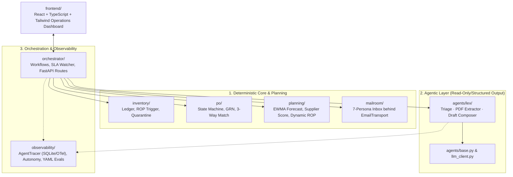

# InvPlan — Demand-to-Delivery & Inventory Planning Prototype

> **Project Status:** Phase 1 MVP (Slices 1–5) + Phase 2 + PRD Fixes (`F-1.1`–`F-4.3`) Complete & Verified  
> **Context:** A portfolio project built to practice **Product Management** and **Agentic Engineering**—translating recurring operational pain points gathered from Supply Chain Management (SCM) communities into a working, guardrailed prototype built with **Google Antigravity CLI**.
>
> *Note: This repository is an architectural and product prototype meant to demonstrate problem framing, system design, and agentic engineering practices rather than a packaged, end-user runnable distribution.*

---

## 1. Problem Discovery & Product Framing

Across SCM discussions, inventory and procurement teams consistently describe the same operational bottleneck: triggering a purchase order is easy, but everything *after* the PO is sent collapses into manual email tracking, scattered spreadsheets, and reactive firefighting. Critical supplier replies get buried, silent non-deliveries go unnoticed until a technician hits an empty bin, and mismatched invoices freeze usable stock.

**InvPlan** reframes the workflow from **chasing every PO manually** to **managing by exception** across six core pain points:

| Pain Point | Operational Failure Today | InvPlan Product & System Response |
|---|---|---|
| **1. Unacknowledged POs (Ghosting)** | Suppliers never reply to a PO; no automated follow-up cadence exists. | Deterministic SLA watcher tracks acknowledgment windows, triggers follow-up drafts, and escalates unresponsive suppliers. |
| **2. Missed Supplier Exceptions** | Price hikes, quantity cuts, or stockouts arrive by email and sit unread. | **Lex** triages inbound emails into structured intents, computes exact INR/stockout impact, and surfaces inline-CTA alerts. |
| **3. Unassessed Post-Ack Delays** | Delays after acknowledgment are either ignored or cause unnecessary panic. | Deterministic days-of-supply math distinguishes safe-buffer delays from `DELAYED_CRITICAL` stockout threats. |
| **4. Silent Non-Deliveries** | Suppliers miss promised ETAs without warning; discovered only at stockout. | Simulated clock + SLA watcher flags `OVERDUE` POs and penalizes supplier reliability scores immediately. |
| **5. PO–Invoice & Quality Mismatches** | Shipments arrive damaged or with wrong prices/quantities/credit notes; goods sit unusable in limbo. | Multimodal PDF extraction feeds deterministic 3-way matching (`PO vs. GRN vs. Invoice`), Credit Note net settlement, Packing List cross-checks, and a physical `DAMAGED` GRN quarantine gate. |
| **6. Static, Blind Planning** | Reorder points ignore changing demand and chronic supplier lateness. | Statistical EWMA demand estimation, actual-vs-quoted lead time tracking, and criticality-weighted safety stock generate explainable ROP/$S$ recommendations. |

---

## 2. Agentic Engineering Philosophy: Right Tool for Each Job

A central design principle in InvPlan is knowing **where not to use an LLM**. Using generative models for inventory arithmetic, state transitions, or timer math introduces hallucination risk where deterministic code is exact, fast, and auditable. Conversely, rigid parsers break on messy supplier emails and inconsistent PDF invoice layouts.

| Layer | Approach | Responsibility |
|---|---|---|
| **Deterministic Core** | Pure Python + SQLAlchemy (`inventory/`, `po/`, `core/`) | Inventory position (`on_hand + on_order + quarantined`), duplicate-PO prevention, MOQ rounding, explicit allow-listed PO state machine, 3-way invoice match arithmetic, and persisted `SimulatedClock`. |
| **Planning Intelligence** | Deterministic Statistics (`planning/`) | 12-month EWMA demand forecasting (`alpha = 0.25`) with intermittent-demand handling, 4-factor Supplier Reliability Score (`40/25/20/15`), effective lead time blending, and Z-factor dynamic ROP/$S$. |
| **Targeted AI Agent (`Lex`)** | `google-genai` (`gemini-3.5-flash-lite`) + Strict Pydantic Schemas (`agents/lex/`) | Multimodal inbound email & PDF triage (quotes, dispatch advices, waybills), multi-PDF invoice/credit-note/packing-list extraction, Making `.csv` BOM stock-request triage, and context-/CC-/INR-grounded outbound drafting. **Zero direct database writes.** |
| **Workflow Orchestration** | `orchestrator/` | Sole cross-module coordinator enforcing confidence guardrails, invoking domain services, and managing SLA timers. |

### Safety Guardrails & Human-in-the-Loop (HITL) Trust Boundaries
- **Draft-First Outbound Rule:** Every email drafted by Lex enters `DRAFT_PENDING_APPROVAL` and requires `InventoryManager` approval before dispatch. Outcomes (`APPROVED_AS_IS`, `APPROVED_EDITED`, `REJECTED`) are tracked per action category in `autonomy_policies` to measure trust before graduating categories in later phases.
- **Confidence & Currency Escalation Gates:** Inbound triage or invoice extractions below `0.85` confidence (or missing key identifiers, encrypted/unreadable PDFs, multi-PO consolidated PDFs, or foreign-currency `USD` quotes vs. `INR` POs) force an `AMBIGUOUS`, `CURRENCY_MISMATCH`, or `INVOICE_EXTRACTION_REVIEW` escalation with **zero blind PO or inventory state mutation**.
- **Billing & Quality Quarantine Locks:** Goods with mismatched invoices or `condition="DAMAGED"` GRNs are held in `quarantined_stock` (excluded from usable `on_hand_stock`) until resolved, while still accounted for in inventory position checks so no duplicate replenishment PO is spawned during a dispute.

---

## 3. System Architecture & Decoupling

InvPlan is structured into strictly isolated vertical modules so agents and developers can reason about one domain without loading unrelated context:



### Enforced Architectural Boundaries
Hard decoupling rules in [`AGENTS.md`](AGENTS.md) are verified programmatically via AST checks in [`tests/test_architecture.py`](tests/test_architecture.py):
- **No sideways imports** between `backend/inventory/`, `backend/po/`, `backend/mailroom/`, `backend/planning/`, and `backend/agents/`. Domain modules may only import `backend/core/` and `backend/observability/`.
- **Single orchestration layer:** Only `backend/orchestrator/` composes multi-domain workflows and exposes FastAPI routes.
- **Swappable mail transport:** All mailroom reads, sends, multi-attachment uploads (`.pdf`, `.csv` BOMs, `.jpg`/`.png` damage photos), and draft approvals/rejections route strictly through the `EmailTransport` protocol in `backend/mailroom/transport.py` (currently backed by a simulated 7-persona DB mailroom: `inventory_manager`, `making`, `procurement`, `Apex Precision (Sup1)`, `Bharat Fasteners (Sup2)`, `Deccan Electro-Spares (Sup3)`, and read-only `lex`).
- **Deterministic simulated time:** Business logic uses `core.clock.now()` (`SimulatedClock`) instead of system wall-clock time so multi-day SLA timelines, overdue penalties, and quarantine escalations are reproducible.
- **Agent-agnostic observability:** `backend/observability/` keys all traces, feedback, eval runs, and autonomy policies by `agent_name` so future agents can plug into the same backbone without schema rework.

---

## 4. How the Prototype Was Built (Agentic Engineering Workflow)

This prototype was developed iteratively using **Google Antigravity CLI** (`agy`) with deliberate context-management and verification discipline:

1. **Product & Technical Specs First:** Locked scope and math in [`PRD.md`](PRD.md) and modular boundaries in [`DESIGN.md`](DESIGN.md) before writing application code.
2. **Context Discipline via Operating Manual:** Maintained [`AGENTS.md`](AGENTS.md) (hard rules and non-negotiable guardrails) and [`STATUS.md`](STATUS.md) (a compact live baton) so each vertical slice ran in a clean, focused session.
3. **Vertical Slice Delivery (Slices 1–5):**
   - **Slice 1:** Deterministic inventory ledger, PO state machine, 3-way match math, and 15-SKU/12-month historical seed data.
   - **Slice 2:** 5-persona `EmailTransport` mailroom, SLA watcher, Lex email triage/drafting, and agent tracing.
   - **Slice 3:** Multimodal PDF invoice extraction pipeline and deterministic planning intelligence engine.
   - **Pre-Slice 4 Audit & Hardening:** Identified and resolved 18 runtime, domain-math, decoupling, and API gaps documented in [`docs/resolved_problems.md`](docs/resolved_problems.md).
   - **Slice 4:** React + TypeScript + Tailwind operations dashboard (`AlertsPage`, `InventoryPage` with direct `Withdraw` & Lex-assisted `Create PO` workflows, `POTrackerPage`, `MailroomPage`, `SuppliersPlanningPage`, persistent `ClockBar`).
   - **Slice 5:** Agent-agnostic YAML eval runner (`backend/evals/lex.yaml` — 30 golden cases across email triage, PDF extraction, stock requests, and draft compliance), `AIHealthPage` trust/eval dashboard, and optional OpenTelemetry/Arize Phoenix integration.
4. **Phase 2 & 50-Scenario Live Stress Testing (`docs/phase2/`, `docs/PRD_FIXES.md`):**
   - **Phase 2 (`docs/phase2/PRD_P2.md`):** Added dispatch logistics tracking (`promised_dispatch_date`, `carrier_name`, `tracking_number`, 2-day deferral/nudge SLA), Making-team stock request & minimum-quantity negotiation workflow, and Procurement escalation.
   - **50-Scenario Live Evaluation & Fixes (`F-1.1`–`F-4.3`):** Executed 50 end-to-end live scenarios against `gemini-3.5-flash-lite` (`docs/test-scenarios/`), closed all 12 discovered bugs/gaps in [`docs/PRD_FIXES.md`](docs/PRD_FIXES.md), and achieved **`16/16 PASS`** on re-verification ([`results-fixes-retest.md`](docs/test-scenarios/results-fixes-retest.md)) plus **`94 passed`** offline unit/integration tests.

---

## 5. Tech Stack

- **Backend:** Python 3.12, FastAPI, SQLAlchemy 2.0, Pydantic v2, SQLite (`uv` for dependency management)
- **AI/Multimodal Extraction:** `google-genai` (`gemini-3.5-flash-lite`) with structured Pydantic outputs
- **Observability & Evals:** SQLite trace/autonomy/eval tables, OpenTelemetry SDK, optional Arize Phoenix export, declarative YAML eval suites (`PyYAML`, `fpdf2` for synthetic PDF fixtures)
- **Frontend:** React 19, TypeScript, Vite, Tailwind CSS v4, `lucide-react`

---

## 6. Quick Start (Local Development)

```bash
# 1. Install backend dependencies & run offline tests (94 passed, 3 live Gemini skipped)
uv sync
uv run pytest -q

# 2. Run FastAPI backend (export GEMINI_API_KEY for live Lex triage/drafts/PDFs)
export GEMINI_API_KEY="your-api-key"
uv run uvicorn backend.main:app --reload --port 8000

# 3. Run React/Vite frontend (http://localhost:5173, proxies /api -> :8000)
cd frontend && npm install && npm run dev
```

---

## 7. Repository Structure & Documentation Map

```text
inv_plan/
├── README.md                     # Project overview, product framing, and architecture
├── PRD.md                        # Master Product Requirements Document (v1.0)
├── DESIGN.md                     # Modular Technical Design & Slice Plan (v1.0)
├── AGENTS.md                     # Agent operating manual & hard decoupling rules
├── STATUS.md                     # Live build baton across Slices 1–5, Phase 2 & PRD Fixes
├── docs/
│   ├── PRD_FIXES.md              # Fixes & gap closure spec (F-1.1–F-4.3)
│   ├── resolved_problems.md      # Pre-Slice 4 audit & resolution ledger (P1–P18)
│   ├── phase2/                   # Phase 2 PRD, design & status (logistics, Making, procurement)
│   └── test-scenarios/           # 50 live scenarios, top-10 demo playbook, fixtures & reports
├── backend/
│   ├── core/                     # Config, DB models, idempotent migrations, SimulatedClock
│   ├── inventory/                # Stock ledger, inventory position, ROP trigger, quarantine
│   ├── po/                       # PO state machine, GRN, 3-way match math, action alerts
│   ├── mailroom/                 # EmailTransport protocol, 7-persona inbox, multi-attachment policy
│   ├── planning/                 # EWMA demand forecast, supplier scoring, dynamic ROP/S
│   ├── agents/                   # BaseAgent, GeminiLLMClient, Lex prompts/schemas/evals
│   ├── observability/            # AgentTracer, AutonomyPolicy tracking, YAML EvalRunner
│   ├── orchestrator/             # Cross-domain WorkflowEngine, SLA watcher, REST routes
│   ├── seed/                     # 15-part, 3-supplier, 12-month historical seed generator
│   └── evals/                    # Golden YAML evaluation suite (lex.yaml — 30 cases)
├── frontend/                     # React + TypeScript + Tailwind operations & AI health UI
└── tests/                        # Unit, integration, live Gemini, and AST architecture tests
```

### Next-Stage Direction
The core deterministic engine, Phase 2 logistics/Making/Procurement workflows, and `PRD_FIXES` (`F-1.1`–`F-4.3`) are complete and verified. Next-stage work includes progressive autonomy graduation per email category (`AutonomyPolicy`), additional specialized agents on `BaseAgent` (e.g., a Manager Query & Visualization Copilot), and external IMAP/Gmail `EmailTransport` integration.
