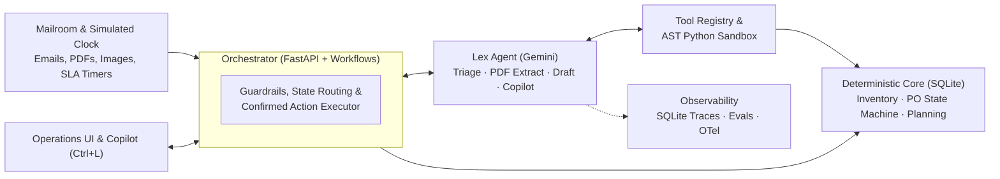

# InvPlan — Inventory Planning with a Guardrailed AI Agent

Most inventory software makes creating a purchase order easy, then leaves the hard part—chasing silent suppliers, decoding messy delay emails, and reconciling mismatched invoices—trapped in an inbox. I built InvPlan to pair a deterministic supply-chain engine with **Lex**, a multimodal AI operations agent and manager copilot that reads supplier emails and PDFs, checks live stock, and drafts responses without ever touching the ledger or sending mail on its own.

<!-- TODO: Hero screenshot or short GIF showing the Inventory & Parts workspace with the Stockout In badges and the Manager Copilot drawer open side-by-side -->
<!-- TODO: Link to 90-second demo video: [Watch the 90-second walkthrough](https://...) -->

**Stack:** Python 3.12, FastAPI, SQLAlchemy, SQLite, Google GenAI (`gemini-3.5-flash-lite`), React 19, TypeScript, Tailwind CSS, OpenTelemetry (optional Arize Phoenix).

---

## The problem

An inventory manager at an industrial parts operation does not have a purchase-order creation problem; they have a follow-up problem. Once a purchase order (PO) is emailed to a supplier, everything that happens next—unanswered orders, surprise price hikes, late shipments, and billing mismatches—arrives as unstructured email. When a supplier reply gets buried, the team only finds out when a shop-floor technician walks to the shelf and hits an empty bin.

InvPlan shifts the workflow from chasing every open order to **managing by exception**. Routine monitoring, reorder math, and follow-up timers run deterministically in code. Lex handles the messy human inputs—emails, PDF invoices, dispatch photos, and natural-language manager questions—and surfaces concise alerts with one-click actions whenever human judgment is needed.

---

## How a delay gets handled

Here is one end-to-end loop in the app, starting from a clean simulated catalog of 15 industrial parts:

1. **Stock drops below the reorder point.** When parts are withdrawn from inventory (or requested by the shop-floor Making team via email), InvPlan checks total pipeline stock against the part's reorder point (the minimum stock level that triggers replenishment). If pipeline stock falls short, the deterministic engine creates a draft PO and Lex writes the supplier dispatch email for approval.
   <!-- TODO: Screenshot 1 — Inventory & Parts table showing BRG-402 after stock withdrawal, with the Stockout In badge and View PO button -->
2. **The manager approves and sends.** On the Open Alerts queue, the manager reviews Lex's draft email and clicks **Approve & Send PO** (or **Edit PO** to adjust quantity or supplier). Only then does the PO move to awaiting acknowledgment and the email leave the outbox.
   <!-- TODO: Screenshot 2 — Open Alerts card for PO_DISPATCH_APPROVAL showing the formatted Lex draft email and Approve & Send PO / Edit PO buttons -->
3. **The supplier replies with a price hike and delay.** In the built-in Mailroom, the supplier sends a messy reply raising the unit price and pushing the delivery date out. Lex triages the email, matches it to the open PO, and extracts the new price and date into a strict schema—without mutating the PO.
   <!-- TODO: Screenshot 3 — Mailroom view switched to a supplier persona showing the inbound delay/price-hike email and Lex's classification badge -->
4. **Deterministic math scores the impact, and the manager decides.** Pure Python computes the exact rupee cost variance and compares the new delivery date against the part's remaining runway (using an exponentially weighted moving average, or EWMA, of daily demand). An alert appears with the projected stockout date, a pre-drafted expedite or revision email, and one-click options to revise the PO or switch to a backup supplier.
   <!-- TODO: Screenshot 4 — Open Alerts exception card showing exact INR price variance, projected stockout gap, and Switch to Backup Supplier CTA -->
5. **The manager asks follow-up questions in the Copilot.** Pressing `Ctrl+L` opens the Manager Copilot side-by-side without closing the active drawer. The manager can ask Lex to compare primary and backup suppliers, plot a chart of 90-day demand, or propose an action card that runs only after explicit confirmation.
   <!-- TODO: Screenshot 5 — Manager Copilot drawer open alongside the 90-Day Cycle Analytics drawer, displaying an interactive SVG chart and a Proposed Action card -->

---

## Architecture



All cross-module workflows flow through `backend/orchestrator/`. Domain packages (`inventory`, `po`, `planning`, `mailroom`, and `agents`) never import from each other, and Lex has zero direct write access to business tables. Long-term supplier notes (`SupplierMemoryNote`), dynamic follow-up timers (`LexReminder`), and multi-turn chat sessions (`CopilotSession`) live in SQLite alongside the core ledger. When the LLM fails—whether from a missing API key or transient HTTP errors after 3 retries with exponential backoff and a 45-second timeout—mailroom triage escalates to an ambiguous-email alert and Copilot returns a non-crashing degraded notice with zero database writes.

For the detailed component diagram, retry status codes, and math formulas, see [docs/ARCHITECTURE.md](docs/ARCHITECTURE.md).

---

## Design decisions that mattered

**I kept the LLM out of arithmetic and state transitions.**
Instead of letting the agent calculate reorder quantities, check 3-way invoice matches (comparing PO, Goods Receipt Note, and PDF invoice), or advance PO states, I restricted Lex to parsing unstructured inputs and proposing actions. Pure Python handles every formula and allow-listed state transition. The tradeoff is more upfront domain code, but it eliminates arithmetic hallucinations and makes every number auditable.

**Every outbound email is draft-first.**
I rejected auto-sending even "routine" follow-ups. In procurement, a hallucinated price acceptance or premature escalation carries real financial and relationship cost. Every Lex draft lands in pending approval, and the system records whether the manager approved it as-is, edited it, or rejected it per category so trust is measured before anything is ever graduated to auto-send.

**Low confidence escalates instead of guessing.**
If Lex's triage or PDF extraction confidence falls below 0.85—or if a quote arrives in USD against an INR order, or a PDF is encrypted or combines multiple POs—the orchestrator halts state changes and routes the item to manual review. The cost is more human triage on messy edge cases; the payoff is zero silent corruption of open orders or stock balances.

**Copilot reasoning is strictly read-only, with propose-then-confirm writes.**
Rather than giving the chat assistant live write tools, Copilot runs against a read-only view of the tool registry (`read_only_only=True`). When the manager asks Copilot to create a PO or update a reorder point, Lex returns a structured action card summarizing the exact change. Nothing executes until the user clicks **Confirm & Execute** (running atomically in one transaction), or **Revise / Clarify Intent** to correct Lex before anything touches the database.

**Simulated time and AST tests enforce architecture automatically.**
Instead of testing multi-day follow-up and overdue timelines against wall-clock time or relying on code review to keep modules decoupled, I built a persisted `SimulatedClock` and five AST tests in `tests/test_architecture.py`. Every test run fails automatically if any module imports sideways across domain boundaries, calls `datetime.now()`, bypasses the mail transport abstraction, or mutates inventory from the PO module.

---

## Tools and guardrails

| Tool category | Permission | Purpose |
|---|---|---|
| State inspection (9 tools) | Read-only | Query live parts, alerts, open POs, 90-day consumption, supplier scorecards, and email threads. |
| Sandboxed calculation (1 tool) | Read-only | Run Lex-written Python inside an AST-validated, step- and time-bounded sandbox (`math`, `statistics`, `datetime`, `decimal`, `json` only). |
| Statistics & visuals (3 tools) | Read-only | Deterministic demand stats, ABC Pareto, supplier benchmarks, and validated SVG charts/diagrams. |
| Advisory memory & reminders (3 tools) | Bounded write | Schedule variable N-day follow-up reminders, save deduplicated supplier memory notes, and raise advisory alerts. |

Every LLM response is constrained to a strict Pydantic schema (avoiding free-form `additionalProperties`, which Gemini's Developer API rejects), and Copilot strips the three write tools completely via `read_only_view()`. Every call—including per-step tool arguments, durations, errors, token counts, and estimated INR cost—is recorded by `AgentTracer` to SQLite and optionally exported over OpenTelemetry to Arize Phoenix. The full 16-tool inventory and 15 Copilot action types live in [docs/ARCHITECTURE.md](docs/ARCHITECTURE.md).

---

## How I tested it

- **Deterministic offline suite (`uv run pytest -q`):** **132 passed, 27 skipped** (verified on the current commit). Covers inventory triggers, PO state transitions, partial-delivery 3-way matching, daily EWMA rollover math, AST sandbox escape attempts, Copilot read-only boundaries, and all 36 offline YAML eval cases. The 27 skipped tests are live Gemini integration tests gated behind `RUN_LIVE_GEMINI=1`.
- **Architectural invariants:** 5 of the 132 offline tests are AST checks in `tests/test_architecture.py` verifying module isolation, simulated-clock discipline, transport abstraction, and agent-agnostic observability.
- **Lint and frontend build:** `uv run ruff check backend tests` passes with zero warnings; `cd frontend && npm run build` passes TypeScript and Vite bundling cleanly.
- **Live model and browser E2E:** Prior verification runs against live `gemini-3.5-flash-lite` passed `9/9` Copilot readiness tests and headless Chromium Playwright E2E flows with zero console or page errors. In the combined 49-test `tests/agents/` live run, 48/49 passed on the first pass and one multi-day nudge timing test failed once before passing on immediate re-run—a reminder that live LLM timing workflows remain nondeterministic.

Failure paths are tested explicitly: unsupported mailroom attachments (`.xlsx`, `.zip`, 0-byte files) return HTTP 400; encrypted PDFs return HTTP 200 and route to manual invoice review without mutating stock; and missing API keys degrade gracefully to logged `DEGRADED` traces.

---

## Evaluation

InvPlan ships with a 36-case declarative YAML eval suite (`backend/evals/lex.yaml`) runnable in either `offline` mode (deterministic fixture responses through real guardrails) or `live` mode against `gemini-3.5-flash-lite`. Pass/fail is decided by exact and threshold field assertions on parsed outputs, tool-call names, and compliance checks (such as mandatory CCs and INR currency grounding).

| Eval category | Cases | What it checks |
|---|---:|---|
| Email triage | 16 | Intent classification, PO matching, price/ETA extraction, `< 0.85` escalation, multi-PO splitting, deferral routing. |
| Email drafting | 7 | Mandatory CCs, INR grounding, structured Markdown, zero unauthorized commercial commitments. |
| Stock request triage | 5 | SKU/quantity extraction from shop-floor emails and `.csv` BOMs, unknown-SKU flagging. |
| Invoice extraction | 4 | Verbatim PDF line items, missing invoice number confidence cap, low-confidence escalation. |
| Reminder wakeup | 2 | Drafts follow-up only when dispatch details remain missing; stays silent once goods or tracking arrive. |
| Copilot query | 2 | Statistical/chart tool invocation, verified SKU citations, and non-mutating PO action proposals. |

**Results:** `36/36` (100%) in offline mode (verified in `pytest` on this commit) and `36/36` in the last live `gemini-3.5-flash-lite` run. Separately, a 16-scenario live stress suite covering damaged goods, credit notes, USD quotes, and encrypted PDFs scored `16/16` across 61 Gemini calls (109,519 tokens; estimated at ₹0.99 INR using local configured token rates of ₹6.30/1M input and ₹25.20/1M output, not a billing invoice).

**Limits of this eval:** I authored these 36 cases alongside the system, so a 100% pass rate is a regression bar—not an independent benchmark. It does not measure performance on unseen supplier writing styles, multi-language invoices, or long-term prompt drift in production.

---

## What I left manual and honest limits

- **Outbound email and PO mutations stay human-approved.** Even though `AutonomyPolicy` tracks edit-free approval rates per email category, auto-send is intentionally off until real operational trust data exists.
- **Simulated mailroom and clock.** Email runs on a SQLite implementation of `EmailTransport` and time advances via the UI clock rather than a cron daemon. *Next step:* swap in an IMAP/Gmail transport and a background scheduler without touching domain modules.
- **Single-warehouse, 15-SKU scope.** Forecasting and replenishment model one facility in INR with no multi-warehouse transfers or ERP webhooks. *Next step:* add warehouse-scoped ledgers and ERP sync adapters.
- **Model and schema sensitivity.** Changing models or Pydantic schemas can break structured output (for instance, Gemini rejects `dict[str, Any]` schemas). *Next step:* gate every model upgrade on the live eval suite plus independently sourced supplier email fixtures.

---

## Run it locally

```bash
uv sync && uv run pytest -q                     # Install backend deps & run 132 offline tests
uv run uvicorn backend.main:app --reload        # Start FastAPI backend on :8000
cd frontend && npm install && npm run dev       # Start React UI on :5173 (proxies /api -> :8000)

# Optional: run the 27 live Gemini tests (requires GEMINI_API_KEY)
export GEMINI_API_KEY="your-key"
RUN_LIVE_GEMINI=1 uv run pytest -v tests/agents/
```

---

## Further reading

- [docs/ARCHITECTURE.md](docs/ARCHITECTURE.md) — Detailed system diagram, full 16-tool inventory, 15 Copilot actions, retry config, and math reference.
- [PRD.md](PRD.md) — Core product requirements, user workflows, and trust boundaries.
- [DESIGN.md](DESIGN.md) — Modular backend design, database schema, and observability architecture.
- [AGENTS.md](AGENTS.md) — Operating rules and hard decoupling invariants enforced across development.
- [docs/phase2/DESIGN_P2.md](docs/phase2/DESIGN_P2.md) — 7-persona mailroom, shop-floor stock requests, and logistics tracking design.
- [docs/phase3/DESIGN_P3.md](docs/phase3/DESIGN_P3.md) — 90-day daily EWMA burn engine, cycle analytics, and Lex tool-use loop.
- [docs/phase4/DESIGN_P4.md](docs/phase4/DESIGN_P4.md) — Manager Copilot read-only boundary, statistical/chart tools, and action confirmation flow.
