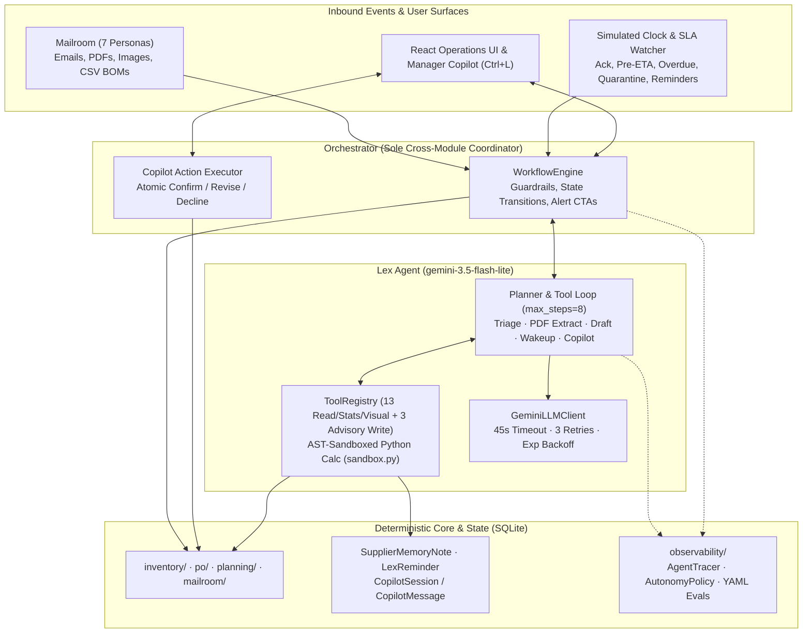

# InvPlan Technical Architecture & Reference

This document holds the detailed component specs, full tool inventory, Copilot action types, retry configuration, and architectural invariants referenced from the top-level [`README.md`](../README.md).

---

## 1. Detailed System & Agent Architecture

---

## 2. Full Tool Inventory (`backend/orchestrator/lex_tools.py`)

Tools are defined domain-agnostically via `ToolSpec`, `ToolResult`, and `ToolRegistry` in [`backend/agents/tools.py`](../backend/agents/tools.py) and bound to SQLAlchemy sessions inside `orchestrator/lex_tools.py`.

In Manager Copilot mode, `ToolRegistry.read_only_view()` (`read_only_only=True`) strips all `read_only=False` tools so Copilot reasoning cannot write to any table.

| Tool Name | `read_only` | Purpose |
|---|---:|---|
| `list_parts_summary` | `True` | Returns live stock, burn rate, runway, urgency tier, and active PO status across all 15 SKUs. |
| `list_alerts` | `True` | Lists `OPEN` and unresolved `DISMISSED` `ActionItem` alerts with severity and payload summaries. |
| `get_planning_overview` | `True` | Returns dynamic `ROP/T` recommendations and supplier scorecards across the catalog. |
| `get_part_snapshot` | `True` | Full snapshot for a single SKU (on hand, on hold, on order, inventory position, active PO, unresolved dismissed alerts). |
| `get_consumption_history` | `True` | Trailing daily consumption series for a part by SKU or ID. |
| `get_po_details` | `True` | Full PO record including supplier, terms, ETAs, GRNs, invoices, and logistics status. |
| `list_open_pos` | `True` | Lists all non-closed, non-cancelled POs (optionally filtered by supplier or part). |
| `get_supplier_profile` | `True` | Reliability score breakdown, effective lead time, response latency, and `SupplierMemoryNote` list. |
| `get_mailroom_thread` | `True` | Full email thread history for a `thread_id`. |
| `run_sandbox_calc` | `True` | Executes Lex-written Python inside an AST-validated, step- and wall-clock-bounded calculation sandbox (`backend/agents/sandbox.py`). |
| `run_statistical_analysis` | `True` | Deterministic supply-chain statistics (`part_demand_stats`, `inventory_abc_pareto`, `supplier_benchmark`, `series_stats`). |
| `render_chart` | `True` | Validates and emits interactive SVG chart specs (`bar`, `grouped_bar`, `line`, `area`, `donut`, `scatter`) with optional reference lines. |
| `render_diagram` | `True` | Validates and emits node-edge diagram specs (`flow`, `decision`, `timeline`). |
| `schedule_lex_reminder` | `False` | Persists a `LexReminder(PENDING)` row for variable N-day supplier follow-up deferrals. |
| `propose_memory_note` | `False` | Saves a deduplicated (Jaccard/substring) `SupplierMemoryNote` for operational patterns. |
| `create_advisory_alert` | `False` | Creates a grounded advisory `ActionItem` when supplier memory or risk checks warrant manager attention. |

### Calculation Sandbox Rules (`backend/agents/sandbox.py`)
- **Allowed modules:** `math`, `statistics`, `datetime`, `decimal`, `json`.
- **Blocked:** Non-allowlisted imports, `open`, `eval`, `exec`, `compile`, `__import__`, `getattr`/`setattr`/`delattr`, dunder attribute escapes, filesystem/process attributes (`system`, `popen`, `unlink`, `read_text`, etc.), and wall-clock methods (`now`, `utcnow`, `today`).
- **Execution bounds:** `sys.settrace` step-count cap and wall-clock execution timeout.

---

## 3. Manager Copilot Action Types (`backend/orchestrator/copilot_actions.py`)

When the Manager asks Copilot to take an operational action, Lex returns `CopilotProposedAction` cards with typed `CopilotActionParam` key-value pairs (no `additionalProperties` / `dict[str, Any]` in Gemini `response_schema`). Nothing executes until the user clicks **Confirm & Execute**; all actions in a card run inside a single SQLAlchemy transaction and roll back atomically on validation failure.

| `CopilotActionType` | Effect on Confirm |
|---|---|
| `CREATE_MANUAL_PO` | Creates a PO in `PENDING_DISPATCH_APPROVAL` and drafts a supplier dispatch email. |
| `APPROVE_DRAFT_EMAIL` | Approves and sends a `DRAFT_PENDING_APPROVAL` email (updating `AutonomyPolicy` counters). |
| `REJECT_DRAFT_EMAIL` | Rejects a pending draft email without resolving its parent alert. |
| `DISPATCH_EDITED_PO` | Updates supplier/qty/price on a pending PO and dispatches the revised email. |
| `SWITCH_BACKUP_SUPPLIER` | Cancels the stalled/disputed PO, clears quarantine if applicable, and creates a backup PO. |
| `CANCEL_PO` | Cancels an active PO and clears associated quarantine holds. |
| `UPDATE_PO_NOTES_OR_ETA` | Updates PO notes or `revised_eta` (preserving original `promised_eta` for OTD scoring). |
| `WITHDRAW_STOCK` | Records a stock consumption event and evaluates replenishment triggers. |
| `RECORD_GRN` | Logs a Goods Receipt Note and triggers 3-way matching if an invoice is already on file. |
| `DISMISS_ALERT` | Marks an `ActionItem` `DISMISSED` and rejects any unapproved linked draft. |
| `REOPEN_ALERT` | Reopens a dismissed alert and restores its pending draft if the PO is still open. |
| `APPLY_ROP_RECOMMENDATION` | Persists the recommended dynamic `ROP` and target stock `T` on the part. |
| `RECALCULATE_PLANNING` | Re-runs demand forecasting, supplier scoring, and `ROP/T` recommendation sweep. |
| `ADD_SUPPLIER_MEMORY_NOTE` | Adds a `MANAGER_ADDED` note to a supplier's memory profile. |
| `SCHEDULE_LEX_REMINDER` | Schedules a `LexReminder` wakeup for a specific PO and simulated date. |

---

## 4. LLM Client, Retries, Timeouts & Tracing (`backend/agents/llm_client.py`)

- **Model:** `gemini-3.5-flash-lite` via `google-genai` (`$GEMINI_API_KEY`).
- **HTTP Timeout:** `45.0s` default (`HttpOptions(timeout=45000)`).
- **Retries:** Up to `3` retries (`4` total attempts) with exponential backoff starting at `0.5s` (`0.5s`, `1.0s`, `2.0s`) on transient errors: HTTP status codes `{408, 429, 500, 502, 503, 504}`, `TimeoutError`, `ConnectionError`, `OSError`, and `resource_exhausted` / `unavailable` / `timed out` messages. Non-transient errors fail fast.
- **Tool Loop:** `generate_with_tools` sets `AutomaticFunctionCallingConfig(disable=True)` and runs a bounded loop (`max_steps=8`), recording cumulative token counts and per-step tool execution metadata (`tool`, `args`, `result_summary`, `duration_ms`, `error`) to `AgentTracer`.
- **Graceful Degradation:** Missing `$GEMINI_API_KEY` or exhausted retries return `AMBIGUOUS_EMAIL` alerts (mailroom triage) or HTTP `200` with `degraded: true` (Copilot), logging a `DEGRADED` row in `agent_traces` with `confidence=0.0` and zero business-table writes.
- **Cost Estimation (`backend/observability/tracer.py`):** Configured at `₹6.30` per 1M input tokens and `₹25.20` per 1M output tokens (~`$0.075` / `$0.30` per 1M at `₹84/USD`). This is a local token-based estimate rather than a live billing API query.

---

## 5. Enforced Architectural Invariants (`tests/test_architecture.py`)

Five AST tests run as part of the standard `pytest` suite:
1. `test_no_sideways_imports_between_domain_modules`: `inventory/`, `po/`, `mailroom/`, `planning/`, and `agents/` never import from each other.
2. `test_no_wall_clock_datetime_calls_in_domain_logic`: Zero `datetime.now()` or `datetime.utcnow()` calls across domain, `orchestrator/`, and `observability/` modules—all code uses `core.clock.now()`.
3. `test_po_module_does_not_mutate_inventory_tables_directly`: `po/` never references `InventoryTransaction` or assigns `on_hand_stock` / `quarantined_stock`.
4. `test_mailroom_service_delegates_strictly_through_email_transport`: `mailroom/service.py` never queries `POCommunication` directly, preserving `EmailTransport` swappability.
5. `test_observability_module_remains_agent_and_domain_agnostic`: `observability/` never imports any domain module or `agents/*`.

---

## 6. Deterministic Math Reference

- **Daily Burn Forecast (`backend/planning/ewma_daily.py`):** 90-day daily EWMA with `α = 0.30` over completed IST days (`2026-07-03` through `yesterday`). Same-day demand events update stock and runway immediately while leaving today's predicted burn frozen until midnight rollover.
- **Dynamic ROP / Target Stock (`backend/planning/rop.py`):** Criticality `Z`-factors (`CRITICAL = 2.05`, `STANDARD = 1.65`, `LOW = 1.28`), `SS = Z * sqrt(L_eff * sigma_D^2 + D_bar^2 * sigma_L^2)`, `ROP = ceil(D_bar * L_eff + SS)`, `T = ROP + ceil(D_bar * target_coverage_days)`.
- **Supplier Reliability Score (`backend/planning/scoring.py`):** Weighted 0–100 score across OTD (40%, with `-2 pts/day` avg late penalty), Lead Time Consistency (25%, measured on `actual_lt - quoted_lt` deviations), v1 Invoice Accuracy (20%), and Responsiveness (15%, 0-nudge acknowledgments). Effective lead time uses quoted LT for `< 3` closed deliveries and `max(actual_mean, 0.25 * quoted + 0.75 * actual_mean)` for `>= 3`.
- **3-Way Invoice Match (`backend/po/matching.py`):** `qty_ok = (invoice_qty == grn_received_qty)` (supporting partial deliveries), `price_ok = abs(invoice_unit_price - po_unit_price) <= ₹0.50`, `math_ok = abs(line_subtotal - qty * unit_price) <= ₹1.00`.
